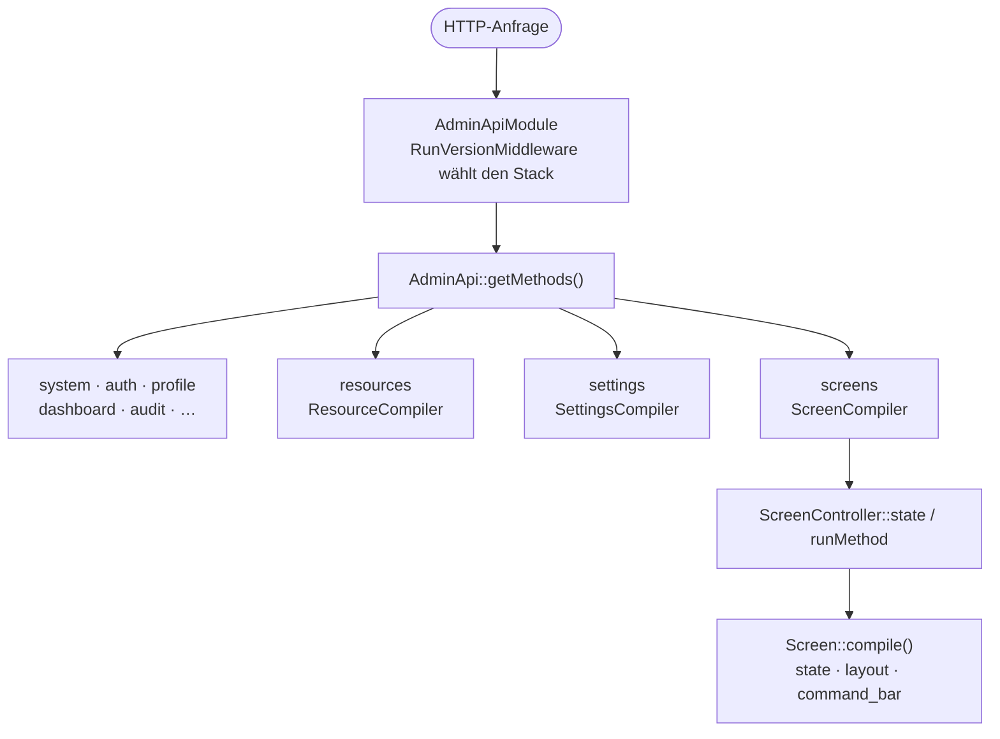
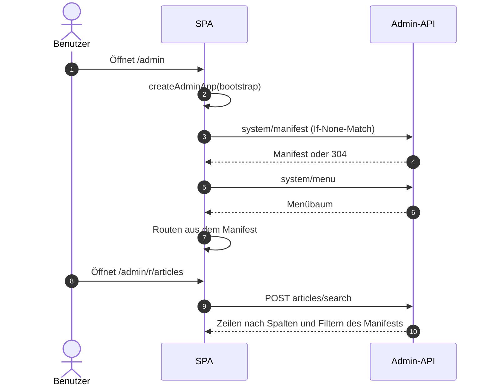
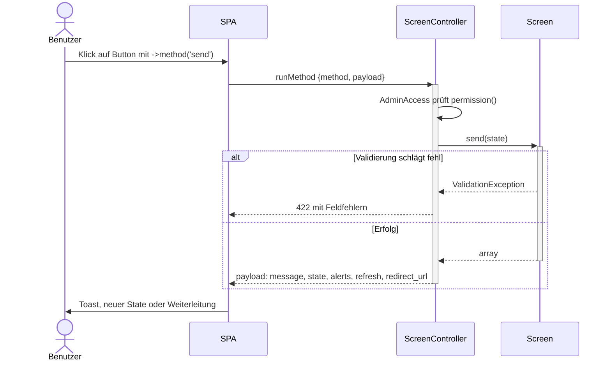

# Architektur

Dieses Dokument beschreibt das übergeordnete Design von `laravel-admin`. Das
ausführliche Designdokument mit der Begründung jeder Entscheidung liegt im
Repository unter `docs/internal/architecture.md` (auf Russisch,
~1500 Zeilen).

## Ziele

1. **Resource-first.** Die meisten Seiten eines Admin-Panels sind CRUD.
   Deklarieren Sie ein Eloquent-Modell als `Resource` und erhalten Sie
   Liste/Anlegen/Bearbeiten/Ansicht ohne Mehraufwand.
2. **Komponierbar über CRUD hinaus.** Stellt die Primitive
   `Screen`/`Layout`/`Field`/`Action` bereit, damit Nicht-CRUD-Seiten
   (Formulare, Berichte, Dashboards) dieselbe Render-Pipeline nutzen.
3. **JSON-gesteuerte SPA.** Ein einziges Bundle, ausgeliefert von
   `@dskripchenko/laravel-admin`, hydriert aus einem Manifest. Der Host
   schreibt PHP, die SPA rendert. Keine zwei Admin-Panels sind gleich
   verdrahtet.
4. **Kein Vendor-Lock-in.** Editor / Diagramme / Dateispeicher / Queue sind
   austauschbar. Sister-Packs sind optional.
5. **Bereit für Mandantenfähigkeit.** Die Auflösung des Mandanten erfolgt auf
   der Host-Seite. Wir stellen Verträge bereit
   (`TenantResolver`/`TenantContext`/`TenantScoped`).

## Ablauf im Überblick

Eine Anfrage an die Admin-API läuft durch ein Modul, das sie an die Methode weitergibt, die das Panel für die Ressource, die Einstellungen oder den Screen kompiliert hat:



Die SPA startet aus dem Bootstrap, lädt Manifest und Menü und baut daraus ihre Routen; danach fragt jede Seite die API nach ihren Daten:



## PHP-Schichten

| Schicht | Was | Datei |
|---|---|---|
| `Admin` | Manager-Fassade. Einstiegspunkt für `resources/screen/menu/...`. | `src/Admin.php` |
| `Resource` | Modell-Wrapper: Felder/Spalten/Filter/Actions. | `src/Resource/Resource.php` |
| `Screen` | Abstrakte Seite (`query`/`layout`/`commandBar`). | `src/Screen/Screen.php` |
| `Field` | Deskriptor eines Formular-Eingabefelds. | `src/Field/*` |
| `Layout` | Renderbarer Container (Rows/Columns/Tabs/...). | `src/Layout/*` |
| `Action` | Button/Link/Bulk/Modal/Async. | `src/Action/*` |
| `Filter` | Tabellenfilter. | `src/Filter/*` |
| `Widget` | Dashboard-Kachel. | `src/Widget/*` |
| `MenuNode/MenuRegistry` | Hierarchischer Baum der Seitenleiste. | `src/Menu/*` |
| `Permission` | RBAC (Role/Permission, Middleware AdminAccess). | `src/Permission/*` |
| `Audit` | `AuditLog` + Trait `Loggable`. | `src/Audit/*` |
| `Settings` | Singleton-Konfigurations-Screens. | `src/Settings/*` |
| `Tenancy` | Verträge Resolver/Context. | `src/Tenancy/*` |
| `Plugin` | Interface `AdminPlugin`, `PluginRegistry`. | `src/Plugin/*` |
| `Theme/I18n` | ThemeManager, LocaleResolver. | `src/Theme/*`, `src/I18n/*` |
| `Http/AdminApi` | Bildet alles oben Genannte in `getMethods()` für laravel-api ab. | `src/Http/AdminApi.php` |

## Frontend-Schichten

| Schicht | Was | Pfad |
|---|---|---|
| `createAdminApp` | Einstieg: Client, Stores, Router, Registries, Mount. | `resources/ts/createAdminApp.ts` |
| Stores (Pinia) | auth/manifest/menu/theme/locale/notifications/resourceIndex/resourceForm/screen/dashboard. | `resources/ts/stores/*` |
| Router | `buildRoutesFromManifest` + Auth-Guard + Title-Guard. | `resources/ts/router/*` |
| Render | `FieldRenderer`, `LayoutRenderer`, `WidgetRenderer`, `provideFormState`. | `resources/ts/components/render/*` |
| Seiten | `HomePage`, `ResourceIndexPage`, `ResourceFormPage`, `ResourceViewPage`, `ScreenPage`, `DashboardPage`, `ProfilePage`, `ImportWizardPage`, `FieldGalleryPage`. | `resources/ts/components/*` |
| Shell | `AdminApp`, `AdminTopBar`, `AdminSidebar`, `AdminSidebarNode`, `BrandLogo`, `NotificationsDrawer`. | `resources/ts/components/shell/*` |

## Zentrale Verträge

### Manifest

Die einzige Quelle der Wahrheit für die SPA, geliefert von `/api/admin/system/manifest`:

```json
{
  "version": "3f9a0c…",
  "locale": "en",
  "panel": "admin",
  "resources": [{ "slug": "articles", "label": "Articles", "fields": [...], "columns": [...], ... }],
  "screens":   [{ "slug": "contact", "name": "Contact", "permission": null }],
  "settings":  [{ "slug": "brand", "fields": [...], ... }],
  "dashboards":[{ "slug": "content", "label": "Analytics", "widgets": [...] }],
  "plugins":   [...],
  "permissions": []
}
```

Gecacht über ETag (`If-None-Match` / `304`).

### Screen::compile()

Universeller Payload für jeden Screen (generiert oder benutzerdefiniert):

```json
{
  "state": { "form_field": "value", ... },
  "name": "Contact",
  "description": "Reach the team",
  "layout": [ { "type": "rows", "children": [ { "kind": "field", ... } ] } ],
  "command_bar": [ { "kind": "action", "type": "button", "name": "send", ... } ],
  "permissions": [],
  "etag": "0123abcd..."
}
```

### Dispatch von Actions

Actions rufen eine Methode auf der PHP-Seite auf. Eine `Screen`-Action geht an
`ScreenController::runMethod` und benennt die öffentliche Methode des Screens:

```json
{ "method": "send", "payload": { "form_field": "value" } }
```

Der Weg einer Screen-Action, vom Klick bis zu dem, was der Benutzer sieht:



Eine `Resource`-Action geht an `ResourceController::action`, benennt die
Action über ihren Schlüssel und übergibt die ausgewählten Datensätze; die
Methode der Resource wird als `$resource->{method}(array $ids, array $payload)`
aufgerufen:

```json
{ "key": "publish", "ids": [1, 2], "payload": {} }
```

Beide geben eine normalisierte `payload`-Struktur zurück (`message`, `alerts`,
`state`, `refresh`, `redirect_url`, `download_url`).

## Berechtigungsmodell

- Eine Berechtigung ist ein String: `admin.{resource}.{action}` (z. B.
  `admin.articles.update`).
- Wildcards: `admin.articles.*`, `*`.
- Rollen enthalten Listen von Berechtigungen (`Role::permissions = ['*']`).
- Benutzer haben Rollen. `User::hasAccess($p)` prüft transitiv.
- Die Middleware `AdminAccess` setzt dies bei jeder Action durch.
- `ResourceCompiler` hängt automatisch das passende
  `AdminAccess:{permission}` an jede generierte Route.

## Austauschbare Bereiche

| Bereich | Standard | Wie überschreiben |
|---|---|---|
| WYSIWYG | `@dskripchenko/wysiwyg` | `registerField('wysiwyg', QuillField)` |
| Dateispeicher | `config('admin.uploads.disk')` (`ADMIN_UPLOADS_DISK`, standardmäßig `local`) | Konfiguration / Disks des Hosts |
| PDF-Rendering | mPDF oder dompdf, je nachdem, was installiert ist | `admin.exports.pdf.driver` = `mpdf` / `dompdf` |
| Diagramme | Eingebaute SVG-Widgets | `registerWidget('chart', MyChart)` |
| Auth-Guard | `auth.guard = admin` | Konfiguration |
| Benutzermodell | `AdminUser` | `Authenticatable` des Hosts |
| Quelle der Locale | 6-stufiger `LocaleResolver` | `admin.ui.default_locale` und die übrige Konfiguration |

## Siehe auch

- [Glossar](glossary.md) — Terminologie
- [API-Referenz](api-reference.md) — REST-Endpoints
- [Frontend-Erweiterung](frontend-extension.md) — eigene Komponenten auf der Host-Seite
