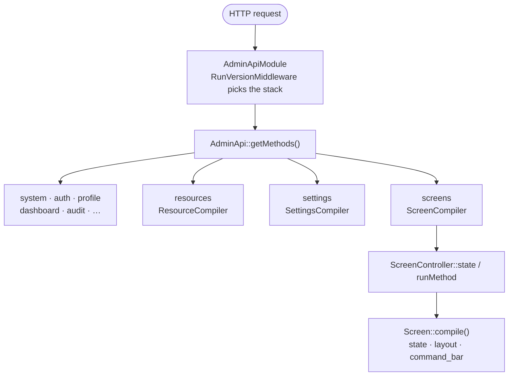
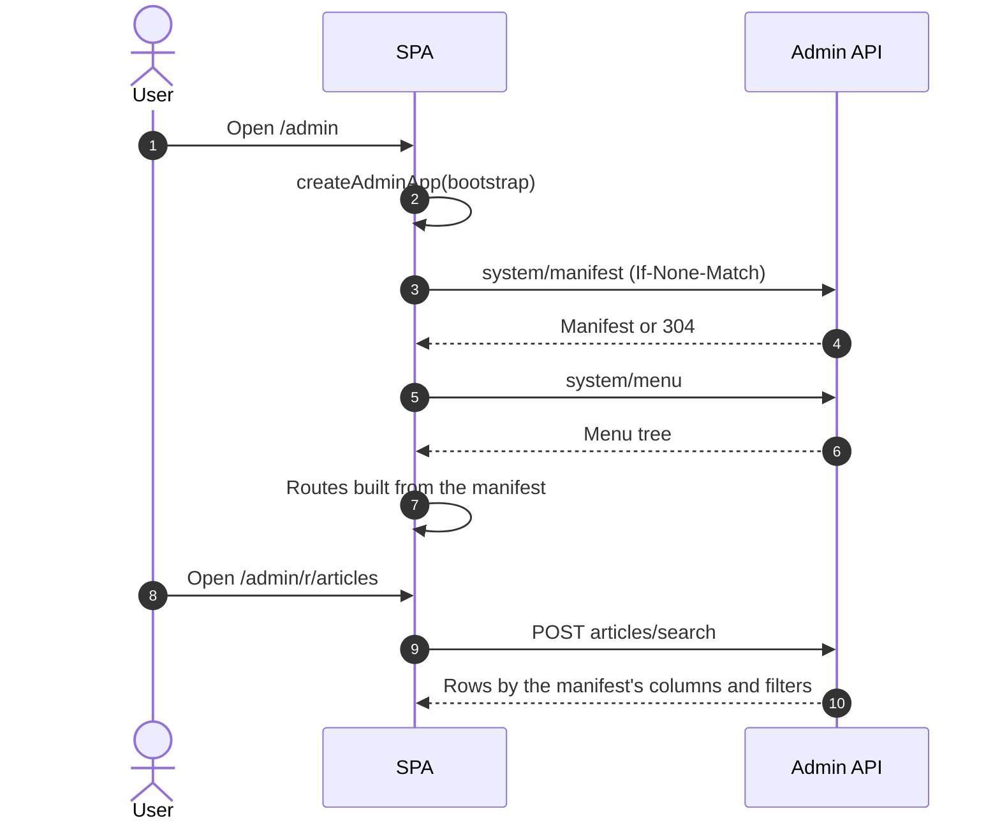
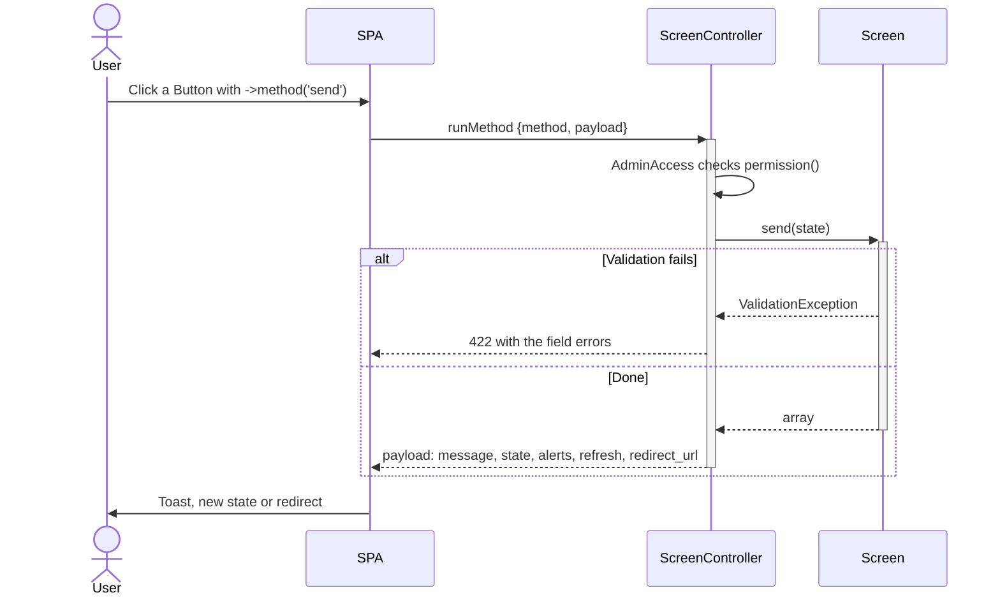

# Architecture

This document describes the high-level design of `laravel-admin`. The
detailed design document with the rationale behind each decision lives in
`docs/internal/architecture.md` in the repository (in Russian,
~1500 lines).

## Goals

1. **Resource-first.** Most pages in an admin are CRUD. Declare an
   Eloquent model as a `Resource` and get list/create/edit/view for free.
2. **Composable beyond CRUD.** Provide `Screen`/`Layout`/`Field`/`Action`
   primitives so non-CRUD pages (forms, reports, dashboards) reuse the
   same render-pipeline.
3. **JSON-driven SPA.** A single bundle served by `@dskripchenko/laravel-
   admin`, hydrated from a manifest. The host writes PHP, the SPA
   renders. No two admins are wired the same way.
4. **No vendor lock-in.** Editor / charts / file-storage / queue are
   pluggable. Sister-packs are optional.
5. **Multi-tenant ready.** Tenant resolution is host-side. We provide
   contracts (`TenantResolver`/`TenantContext`/`TenantScoped`).

## High-level flow

A request to the admin API goes through one module, which hands it to the method the panel compiled for that resource, setting or screen:



The SPA starts from the bootstrap, loads the manifest and the menu, and builds its routes from them; every page then asks the API for its data:



## PHP layers

| Layer | What | File |
|---|---|---|
| `Admin` | Manager facade. Entry point for `resources/screen/menu/...`. | `src/Admin.php` |
| `Resource` | Model wrapper: fields/columns/filters/actions. | `src/Resource/Resource.php` |
| `Screen` | Abstract page (`query`/`layout`/`commandBar`). | `src/Screen/Screen.php` |
| `Field` | Form input descriptor. | `src/Field/*` |
| `Layout` | Renderable container (Rows/Columns/Tabs/...). | `src/Layout/*` |
| `Action` | Button/Link/Bulk/Modal/Async. | `src/Action/*` |
| `Filter` | Table filter. | `src/Filter/*` |
| `Widget` | Dashboard tile. | `src/Widget/*` |
| `MenuNode/MenuRegistry` | Hierarchical sidebar tree. | `src/Menu/*` |
| `Permission` | RBAC (Role/Permission, AdminAccess middleware). | `src/Permission/*` |
| `Audit` | `AuditLog` + `Loggable` trait. | `src/Audit/*` |
| `Settings` | Singleton config screens. | `src/Settings/*` |
| `Tenancy` | Resolver/Context contracts. | `src/Tenancy/*` |
| `Plugin` | `AdminPlugin` interface, `PluginRegistry`. | `src/Plugin/*` |
| `Theme/I18n` | ThemeManager, LocaleResolver. | `src/Theme/*`, `src/I18n/*` |
| `Http/AdminApi` | Maps everything above into `getMethods()` for laravel-api. | `src/Http/AdminApi.php` |

## Frontend layers

| Layer | What | Path |
|---|---|---|
| `createAdminApp` | Entry: client, stores, router, registries, mount. | `resources/ts/createAdminApp.ts` |
| Stores (Pinia) | auth/manifest/menu/theme/locale/notifications/resourceIndex/resourceForm/screen/dashboard. | `resources/ts/stores/*` |
| Router | `buildRoutesFromManifest` + auth-guard + title-guard. | `resources/ts/router/*` |
| Render | `FieldRenderer`, `LayoutRenderer`, `WidgetRenderer`, `provideFormState`. | `resources/ts/components/render/*` |
| Pages | `HomePage`, `ResourceIndexPage`, `ResourceFormPage`, `ResourceViewPage`, `ScreenPage`, `DashboardPage`, `ProfilePage`, `ImportWizardPage`, `FieldGalleryPage`. | `resources/ts/components/*` |
| Shell | `AdminApp`, `AdminTopBar`, `AdminSidebar`, `AdminSidebarNode`, `BrandLogo`, `NotificationsDrawer`. | `resources/ts/components/shell/*` |

## Key contracts

### Manifest

The single source of truth for the SPA, returned by `/api/admin/system/manifest`:

```json
{
  "version": "3f9a0c…",
  "locale": "en",
  "panel": "admin",
  "resources": [{ "slug": "articles", "label": "Articles", "fields": [...], "columns": [...], ... }],
  "screens":   [{ "slug": "contact", "name": "Contact", "permission": null }],
  "settings":  [{ "slug": "brand", "fields": [...], ... }],
  "dashboards":[{ "slug": "content", "label": "Analytics", "widgets": [...] }],
  "plugins":   [...],
  "permissions": []
}
```

Cached via ETag (`If-None-Match` / `304`).

### Screen::compile()

Universal payload for any screen (Generated or custom):

```json
{
  "state": { "form_field": "value", ... },
  "name": "Contact",
  "description": "Reach the team",
  "layout": [ { "type": "rows", "children": [ { "kind": "field", ... } ] } ],
  "command_bar": [ { "kind": "action", "type": "button", "name": "send", ... } ],
  "permissions": [],
  "etag": "0123abcd..."
}
```

### Action dispatch

Actions invoke a method on the PHP side. A `Screen` action goes to
`ScreenController::runMethod` and names the screen's public method:

```json
{ "method": "send", "payload": { "form_field": "value" } }
```

The way of a screen action, from the click to what the user sees:



A `Resource` action goes to `ResourceController::action`, names the action
by its key and carries the selected records; the resource method is called
as `$resource->{method}(array $ids, array $payload)`:

```json
{ "key": "publish", "ids": [1, 2], "payload": {} }
```

Both return a normalized `payload` shape (`message`, `alerts`, `state`,
`refresh`, `redirect_url`, `download_url`).

## Permissions model

- A permission is a string: `admin.{resource}.{action}` (e.g.
  `admin.articles.update`).
- Wildcards: `admin.articles.*`, `*`.
- Roles hold lists of permissions (`Role::permissions = ['*']`).
- Users hold roles. `User::hasAccess($p)` checks transitively.
- `AdminAccess` middleware enforces it on every action.
- `ResourceCompiler` auto-attaches the right `AdminAccess:{permission}`
  to each generated route.

## Pluggable areas

| Area | Default | How to override |
|---|---|---|
| WYSIWYG | `@dskripchenko/wysiwyg` | `registerField('wysiwyg', QuillField)` |
| File storage | `config('admin.uploads.disk')` (`ADMIN_UPLOADS_DISK`, `local` by default) | config / host disks |
| PDF rendering | mPDF or dompdf, whichever is installed | `admin.exports.pdf.driver` = `mpdf` / `dompdf` |
| Charts | Built-in SVG widgets | `registerWidget('chart', MyChart)` |
| Auth guard | `auth.guard = admin` | config |
| User model | `AdminUser` | host `Authenticatable` |
| Locale source | 6-step `LocaleResolver` | `admin.ui.default_locale` and the other config |

## See also

- [Glossary](glossary.md) — terminology
- [API reference](api-reference.md) — REST endpoints
- [Frontend extension](frontend-extension.md) — host-side custom components
