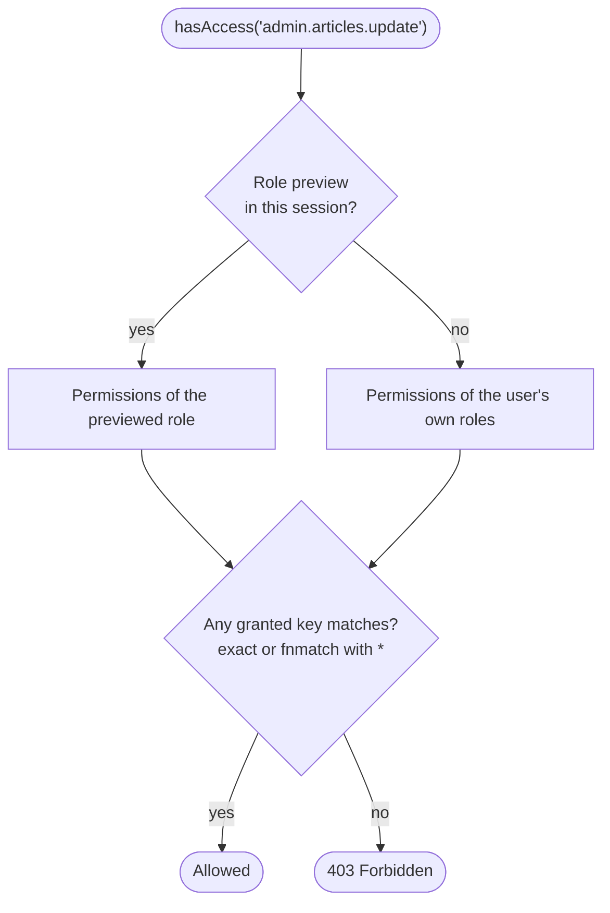

# Permissions

RBAC: users hold roles, roles hold permission strings, every action is
gated by `AdminAccess` middleware.

## Permission keys

Format: `admin.{domain}.{action}`. Examples:

- `admin.users.view`
- `admin.articles.update`
- `admin.system.settings.edit`
- `admin.audit.view`

Wildcards:
- `admin.users.*` — all actions in users domain
- `admin.*.view` — view access to everything
- `admin.*` — all admin permissions
- `*` — superadmin

A granted key with `*` is matched with `fnmatch()`, where `*` also matches
dots: `admin.*` covers `admin.cms.articles.view` as well.

## Roles

Stored in `admin_roles`; `permissions` is a JSON list of strings. A user
model with the `HasAdminAccess` trait gets a role via `assignRole()` (a
`Role`, its id or its slug) and loses it via `revokeRole()`:

```php
$role = Role::create([
    'name' => 'Editor', 'slug' => 'editor',
    'permissions' => ['admin.articles.*', 'admin.media.view'],
]);
$user->assignRole($role);
```

## Resource auto-permissions

For each Resource the admin derives permission keys from
`Resource::permission()` (`admin.{slug}` by default) and guards the
resource's routes with them:

```
admin.articles.view
admin.articles.create
admin.articles.update
admin.articles.delete
admin.articles.restore         (if soft-delete)
admin.articles.force-delete    (if soft-delete)
admin.articles.replicate       (if replicable)
admin.articles.reorder         (if reorderable)
```

`AdminAccess:admin.articles.create` middleware guards the
`create`-route automatically. Custom actions (`POST /{slug}/action`)
require `.view`. These keys are only gates: to make them checkable in the
role editor, register them with `Admin::permissions()` (below).

Override the base via `Resource::permission()`:

```php
public static function permission(): string
{
    return 'admin.cms.articles';   // → admin.cms.articles.view, .update, ...
}
```

## Custom permission registration

```php
use Dskripchenko\LaravelAdmin\Permission\ItemPermission;

Admin::permissions(
    ItemPermission::group('Reports')
        ->addPermission('admin.reports.view', 'View reports')
        ->addPermission('admin.reports.export', 'Export reports'),
);
```

These appear in the role-edit screen as checkable items.

Pass the group name and labels as source strings (or translation keys), not as
`__()` results: groups are registered once at boot, and the labels are
translated through the JSON translations when they are served, in the locale
of that request. A label that is already translated is returned as it is.

## Checking in code

```php
$user->hasAccess('admin.articles.update');   // true / false
$user->hasAnyAccess(['admin.articles.update', 'admin.articles.delete']);  // OR
$user->hasAllAccess(['admin.articles.update', 'admin.articles.delete']);  // AND
```

In the SPA (the bootstrap and the login response carry the user's flat
permission list; the store matches the same `*` masks):

```ts
const auth = useAuthStore()
auth.hasAnyPermission(['admin.articles.update'])
```

## How a check is decided

Every check — `hasAccess()`, the `AdminAccess` middleware, a screen's `permission()` — comes down to the same question:



## Middleware on actions

`AdminAccess` middleware accepts one or more permissions separated by `;`:

```php
'middleware' => [AdminAccess::class.':admin.users.view'],
'middleware' => [AdminAccess::class.':admin.users.view;admin.users.update'],  // AND
```

For OR semantics across permissions — check inside the action handler
explicitly.

## Screens

A Screen declares its gate via `permission()`:

```php
public function permission(): array|string|null
{
    return ['admin.reports.view', 'admin.exports.run'];   // AND
}
```

The `state` (GET), `runMethod` and `listener` (POST) endpoints are
auto-gated. `null` (the default) means authentication alone is enough.

## Settings

Each `SettingsResource` gets `admin.settings.{slug}.view` /
`admin.settings.{slug}.update`.

## Viewing the panel as a role

A Super Admin (the permission `admin.auth.role_preview.permission`, `*` by default, in their **own** roles) picks «View as a role…» in the user menu, and the menu, the screens, the actions and the backend checks answer by that role until they press «Come back» in the bar at the top. `hasAccess()` and `getAllPermissions()` follow the preview by themselves — the host's checks need no change; `hasRealAccess()` answers by the user's own roles. Only the session that started it is affected; Bearer requests and other users are not. Switch it off with `admin.auth.role_preview.enabled = false`. Endpoints: `auth/previewRoles`, `auth/startRolePreview`, `auth/stopRolePreview`.

## 2FA

Independent of RBAC. If enabled per-user, login flow requires the
TOTP code regardless of role.

## See also

- [Resources](resources.md) — auto-permissions per CRUD action
- [Screens](screens.md) — `permission()` method
- [Tenancy](tenancy.md) — tenant-scoped data + permissions
